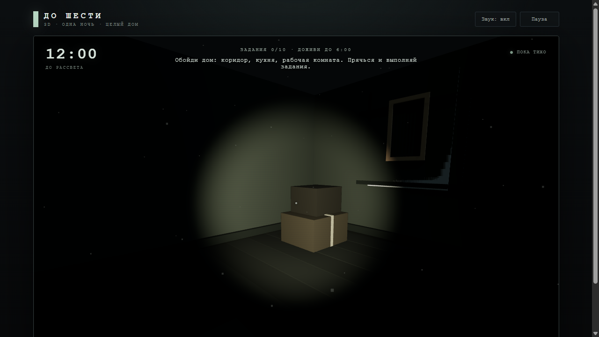
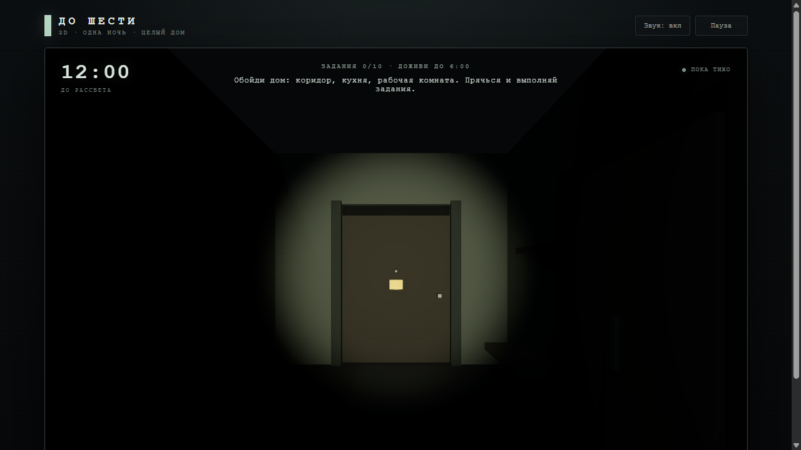
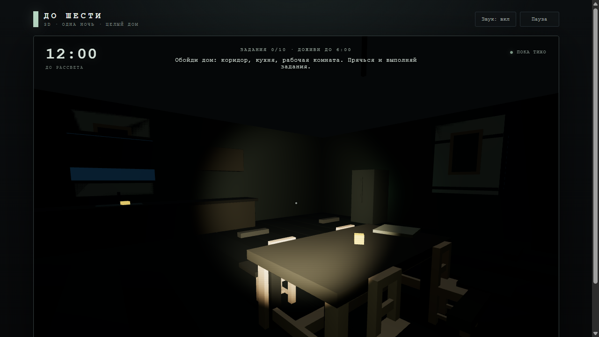

# До шести

**«До шести»** — атмосферный 3D-хоррор от первого лица об одной ночи в доме. За дверью слышны тяжёлые шаги: теневой монстр периодически входит через входную дверь, обходит коридор, кухню, спальню и рабочую комнату в поисках игрока. Ваша цель — прятаться в укрытиях, следить за уровнем шума и дыханием, выполнять задания по дому и продержаться с полуночи до 06:00.

Дом состоит из четырёх комнат: спальни («комната 07»), длинного коридора с входной дверью, кухни и рабочей комнаты. В каждой комнате есть интерактивные предметы, укрытия, окна с лунным светом и задания.

---

## Скриншоты

| Спальня (Комната 07) | Коридор и входная дверь |
| :---: | :---: |
|  |  |

| Кухня и столовая |
| :---: |
|  |

---

## 📥 Скачать игру

Последняя версия **1.4.1** доступна на [странице релизов GitHub](https://github.com/usd8261-blip/scary/releases/tag/v1.4.1):

- 💻 **[Do-Shesti-1.4.1.exe](https://github.com/usd8261-blip/scary/releases/download/v1.4.1/Do-Shesti-1.4.1.exe)** — версия для Windows (Rust + Bevy). Самодостаточный EXE-файл, не требует установки.
- 📱 **[Do-Shesti-Android-1.4.1.apk](https://github.com/usd8261-blip/scary/releases/download/v1.4.1/Do-Shesti-Android-1.4.1.apk)** — версия для Android (APK). Управление экранными кнопками и сенсорным обзором.

---

## Запуск на Windows

1. Скачайте `Do-Shesti-1.4.1.exe` со [страницы последнего релиза](https://github.com/usd8261-blip/scary/releases/tag/v1.4.1).
2. Запустите файл двойным щелчком — установка не требуется.
3. Дождитесь загрузки 3D-сцены и начните ночь.

Готовый EXE — самодостаточная Rust-сборка: шрифты и модель монстра встроены в исполняемый файл, отдельную папку `assets` скачивать не нужно. Версия предназначена для Windows 10/11 x64.

## Запуск на Android

1. Скачайте `Do-Shesti-Android-1.4.1.apk` со [страницы релиза](https://github.com/usd8261-blip/scary/releases/tag/v1.4.1).
2. Откройте файл на телефоне и разрешите установку из этого источника, если Android запросит разрешение.
3. После установки запустите игру через значок приложения.

Требуется Android 7.0 или новее с поддержкой WebGL. Управление выполняется экранными кнопками, обзор — движением пальца по игровому экрану.

## Запуск в браузере

1. Скачайте или клонируйте репозиторий:

   ```bash
   git clone https://github.com/usd8261-blip/scary.git
   cd scary
   ```

2. Запустите локальный HTTP-сервер (например, с помощью Python):

   ```bash
   python -m http.server 8000
   ```

3. Откройте `http://localhost:8000` в современном браузере.
4. Нажмите **«Начать ночь»**.

---

## Сборка Rust-версии из исходников

1. Установите [Rust](https://rustup.rs/) (stable).
2. В папке репозитория выполните:

   ```bash
   cd rust-pc
   cargo run --release
   ```

Исполняемый файл появится в `rust-pc/target/release/do-shesti.exe`.

---

## Цель игры

Доживите до рассвета — до **06:00**. Одна ночь длится **210 секунд** реального времени. Выполненные задания ускоряют наступление утра (каждое задание сдвигает время вперёд). В доме разбросано 10 заданий:
- **Спальня**: закрыть створку окна, починить розетку у стола, настроить винтажный радиоприёмник.
- **Коридор**: проверить замок входной двери.
- **Кухня**: помыть посуду в раковине, закрыть дверцу холодильника, убрать обеденный стол.
- **Рабочая комната**: выключить монитор компьютера, запереть сейф, разобрать документы на полках.

Монстр то уходит, то возвращается в дом через входную дверь и патрулирует все комнаты. Периодически он целенаправленно подходит к укрытиям и прислушивается. Если монстр заметит вас фонариком, услышит шум бега или выполнения задания, он начнёт погоню.

---

## Управление

| Клавиша или действие | Назначение |
| --- | --- |
| `WASD` или стрелки | Передвижение |
| Мышь / свайп | Обзор в 3D |
| `Shift` | Бег (быстрее, но шумно и расходует выносливость) |
| `E` | Спрятаться в укрытие, выйти или взаимодействовать с заданием |
| `Пробел` | Задержать дыхание в укрытии |
| `F` | Включить / выключить фонарик |
| `P` или `Esc` | Пауза |

На сенсорных устройствах управление осуществляется экранными кнопками, а обзор — движением пальца по экрану.

---

## Советы по выживанию

- **Следите за индикатором опасности**: он покажет состояние монстра («у входной двери», «вошло в дом», «бродит по дому», «заметило вас»).
- **Прячьтесь заранее**: в доме 6 укрытий — под кроватью и в шкафу спальни, в шкафу коридора, под мойкой и в кладовой кухни, в шкафу кабинета. Если монстр увидит, куда вы побежали, укрытие не спасёт.
- **Задерживайте дыхание (`Пробел`)**: когда чудовище проходит мимо вашего укрытия, не дышите. Следите за шкалой воздуха — если она иссякнет, персонаж судорожно вдохнёт и выдаст себя.
- **Контролируйте свет и звук**: бег и выполнение заданий создают шум, который слышен издалека. Выключайте фонарик, если монстр находится в соседней комнате.

---

## Технологии

- **Rust PC**: движок [Bevy 0.14](https://bevyengine.org/), рендеринг PBR-материалов, встроенные ассеты, FSM искусственного интеллекта монстра и навигация A*.
- **Web & Android**: HTML5, CSS3, JavaScript (ES modules) и [Three.js r170](https://threejs.org/). Android-версия работает через WebView в нативной обёртке.
- Звуки синтезируются процедурно через Web Audio API в Web-версии и аудио-пайплайн Bevy в PC-версии.
